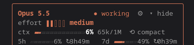

# Personas × journeys

Who arrives, why, what they get at each level, and what brings them back. No
screens: this is the brief that onboarding screens are later drawn from.

Decided 2026-10-24. Draft for discussion.

## Rules this doc is written to

- **Value before Solid.** Nobody is asked to want a pod. The account and the pod
  come as a side effect of "keep it here" once something useful already exists.
  A pod is the new "self-host" for people who can't self-host.
- **Each level is worth it alone.** Someone who stops at L1 has not failed.
- **Nudges support, never nag.** A progress bar is a minimap (saved; stop and
  resume). A curiosity hint is a door: one line, at the moment value lands,
  never repeated. No streaks, leaderboards, scarcity or loss.
- **Personas, not verticals.** A vertical (Maps of Making, HyperScope…)
  customizes the top layer: skin, words, the first useful object. The levels
  underneath are shared.
- **Onboarding is a one-time app per vertical**, on its own subdomain, same site
  as the pod server (ADR 010). Its name is the vertical's to choose, from its
  own story. It can't be a subdomain of the pod server's host, where every
  subdomain is a pod. The backoffice is where people *come back*, not where
  they start.

### Reference: small indicators

The register for progress: small, dense, glanceable. A label, a few segments
or a thin bar, a number. It tells you where you are right now and asks for
nothing. Not a big stepper across the top of the screen.

## The levels

| | Level | What it is | Exists today? |
|---|---|---|---|
| **L1** | Something of mine, kept | A profile (with or without a location) → a file on the pod → backoffice basics: upload, who may see it, link it from the profile | genjson (value, no pod); backoffice J1/J2 (account, profile) |
| **L2** | An agent on my files | An agent identity, connected to an AI, granted folders; talk to your files | yes: backoffice J8 + connector |
| **L3** | Being part of a collective | Claim, announce, accept: a membership either side can end at once. Deeper: share a folder, the collective's knowledge graph answers back | membership yes (J1, J3–J6); the graph loop (pull → confront → graph answers) **no** |

L2 and L3 sit side by side after L1; the person picks either, both or neither.

### What L3 is worth before the loop

Joining is a claim, made in the open, that only recognition makes true:

1. I **claim** it: my profile says I am a member of the collective.
2. I **announce** it: a request lands in the collective's inbox.
3. They **accept**: their roster names me. Now both sides say it.

Anyone can claim anything; a claim nobody recognises is just a line of text.
Either side can **withdraw at once**, without asking the other. It is as light
as writing a line in a ledger, and as easy to cross out.

That lightness is the value: the relation is **live**, easy to make, easy to
end, always reversible. It is the opposite of the usual practice, where
subscribing takes one click and leaving takes a support ticket. It goes
further than a right to deletion: nobody has to ask anyone to let go.

Because joining costs so little, it proves little. What makes the relation
hold is earned elsewhere: trust, shared values, working together. Further
features can build on the recognised relation (a map of members, a shared
folder, the graph loop). The loop is the deeper benefit, from sharing data
across pods; the handshake is worth having without it.

### How the handshake shows (MoM map)

A claim goes both ways. A space declares it is a member of a network; a
network declares a space is its member. A network may list 567 spaces when
only 345 say so too. **Recognised** = both sides say it: that is the
handshake. The network can then tie its recognised list to its own tools (a
CRM checking subscriptions, its governance rules).

Mockup: [Membership chip states](https://claude.ai/artifact/VEb5jhJamiG46cvnXYFyLJ)
(space card, three options, network card).

On the space card the membership chips share the status row: networks
aligned left, `OPEN` aligned right. No extra section, no legend. The words come
on hover or focus (tooltip, and the chip's accessible name): progressive
disclosure.

| State | Space card | Network card |
|---|---|---|
| Declared by the space only | `CANARY`, dashed outline, muted text | "space only" |
| Declared by the network only | not shown: the space never said it | "VULCA only" |
| Recognised by both | `VULCA`, solid outline, `paper-2` fill, ink text | "both", and the count that matters |

- **Dashed vs plain is enough** (option A). Line and fill both carry it, so it
  holds in greyscale and for colour-blind people (WCAG 1.4.1). An arrow for
  who speaks can come later if needed.
- **No ink fill** (on the map it means a pressed filter) and **no blue fill**
  (blue is the protected Confirmed pin state; `bernard-blue` belongs to the
  workshop only).
- **Not the word "claimed"**: on the map it is a pin's public state
  (Unclaimed / Claimed / Live). Memberships say **declared** and
  **recognised**.
- **Tooltip words:** "Declared by Mother Sand. CANARY hasn't recognised it
  yet." / "Member of VULCA: recognised by both".
- **Ended is gone.** The space drops its claim: the chip disappears. The
  network drops it: the chip goes back to dashed.
- **The chip is a door** to the network's card.

**The network card is a draft, to brainstorm.** What it shows is undecided.
Leads so far: the three counts; members sorted by latest activity
(`updated_at`), or newly recognised members first.

## Personas

| # | Persona | Who, concretely | Vertical |
|---|---|---|---|
| P1 | **Space coordinator** | Runs a makerspace, fablab, repair café, a practice (a hackerspace; a speech therapist in Namur). Signs up with a role email (`contact@space`) | MoM |
| P2 | **Network coordinator** | Coordinates a network of spaces. No location of their own | MoM |
| P3 | **Invited member** | A person a collective invited. Has no Solid account, doesn't know what one is | any |
| P4 | **Collective thinker** | Contributes notes to a collective and wants the collective to answer | HyperScope |
| P5 | **Curious about AI on own files** | Wants an assistant that reads their documents, not a cloud drive's | any |
| P6 | **Already on Solid** | Has a WebID elsewhere | any (J2) |
| P7 | **Maintainer** | Runs an instance: deploys the pod server, the backoffice, a vertical's apps | none |

The dentist and the materials dealer from `schema-roleplay-personas.md` are P1
from this doc's point of view: their difference is the bundle, not the journey.

## The grid

Each cell: **trigger** → **value** → **object left with** → **comes back where / why**.
"—" means the level is not that persona's path (they may still take it).

### P1 · Space coordinator

| | |
|---|---|
| **L1** | **Trigger:** wants the space on the map / to be found. **Value:** the space is on the map, from a file they own. **Object:** the space's JSON at a public URL, the link to register on the map. **Comes back:** to update hours, equipment, events, in MoM's backoffice or by telling Bernard's chatbot; the map shows "last updated" |
| **L2** | **Trigger:** questions they answer over and over ("do you have a laser cutter?"). **Value:** an agent that answers from the space's own file. **Object:** an agent identity granted the space's folder. **Comes back:** when the file changes; to read the access log |
| **L3** | **Trigger:** a network invites the space, or the space wants to be seen among its peers. **Value:** the handshake (above): the space is recognised as part of the network, and can leave at once. The network can count who really says so. **Object:** `memberOf` in the space's file, the network's acceptance. **Comes back:** rarely; that's fine |

Bernard is MoM's agent (the Mother Sand lore): the same agent as L2, with
the MoM graph to query. A coordinator who wants their own bot where their
community already talks (Discord, Matrix…) is a side quest: an agent
archetype living standalone, in its own container (the hermes line). TBD.

Handing over: the account is on a role email, so a new coordinator takes the
mailbox and with it the password reset. No account transfer feature needed.

### P2 · Network coordinator

| | |
|---|---|
| **L1** | **Trigger:** wants to show the network. **Value:** the network's page and its members on one map. **Object:** an embed (map of members) to put on the network's own site. **Comes back:** when a space asks to join |
| **L2** | **Trigger:** "which of our spaces does X?" asked by the public. **Value:** a search bot beside the embed, answering from the members' files. **Object:** the bot, run by the **network's** agent, on the same page as the embed. **Comes back:** when it answers wrong |
| **L3** | Is the collective: accepts or refuses requests (J3), sees the roster, can end a membership from its side (J5) | |

This is the persona where L1 and L2 are one gesture: the embed is the value,
the search bot is the reason to keep it fresh. Separately, any member can
connect their own AI to their own pod through the connector; the network's bot
doesn't replace that.

### P3 · Invited member

| | |
|---|---|
| **L1** | **Trigger:** an invitation link from someone they know. **Value:** "you're in", nothing to understand first. **Object:** a pod address, a sign-in that works, a profile with a name. **Comes back:** via the backoffice bookmark, when the collective asks for something |
| **L2** | — (door shown once, after L3 value lands: "your notes could also have an agent") |
| **L3** | **Trigger:** the invitation itself. **Value:** the handshake: recognised as a member, free to leave at once. Later, the collective answering. **Object:** membership; a shared folder. **Comes back:** when the collective asks or answers |

### P4 · Collective thinker

| | |
|---|---|
| **L1** | Minimal: an account and a folder of notes. Never the entry point |
| **L2** | **Trigger:** wants their own notes to answer back. **Value:** talk to own notes. **Object:** an agent on the notes folder. **Comes back:** daily, in their AI chat, not the backoffice |
| **L3** | **Trigger:** a question the collective is working on. **Value:** the collective graph answers, naming who said what; disagreements confronted. **Object:** their contribution visible in the graph's answers. **Comes back:** through the collective's own surface (the graph), not the backoffice. **Blocked:** needs the pull → confront → graph answers loop |

The backoffice shows mechanism (inbox, delegates, agent WebID, folders) and
none of this value. Don't draw P4 screens before the loop exists.

### P5 · Curious about AI on own files

| | |
|---|---|
| **L1** | **Trigger:** "I want an assistant on my files, not on Google's". **Value:** a place for files they control. **Object:** pod + a first folder with something in it. **Comes back:** to add files |
| **L2** | **Trigger:** same, it's why they came. **Value:** the AI reads only the folders they granted; the access log shows each read. **Object:** an agent connected to their AI. **Comes back:** from the AI chat; to the backoffice to grant another folder or read the log |
| **L3** | — (door, once, when the agent first answers well) |

### P6 · Already on Solid

Same grid as whichever of P1–P5 they are, minus the account step. J2 fills
what their profile lacks. The descriptor (ADR 010) decides whether L2 is
offered on their provider.

### P7 · Maintainer

Not onboarded by an app. Their path is each repo's documentation, organised
the Diátaxis way: a tutorial to run a first instance, how-to guides for the
routine (update, back up, add a vertical), reference for the configuration,
explanation for the decisions (the ADRs). Their "comes back" is the CHANGELOG
and the release notes.

## What this tells us to build

1. **MoM's onboarding app** serves P1 and P2 at L1. genjson already gives the
   value without an account; the new part is "keep it at Maps of Making"
   creating the account and pod, then ending on the public JSON link.
2. **P2's embed + search bot** is the strongest single case for L2 and the
   reason to keep files fresh. Worth a slice of its own.
3. **The handshake is already L3's value**: show it as such (claim, announce,
   accept, leave at once), not as a formality waiting for the loop. The loop is
   what P4 needs; P1, P2 and P3 get value without it.
4. **The backoffice** is the "comes back" place for P1 (with Bernard's chatbot),
   P3 and P5. It is never the first screen anyone sees.

## Open questions

- The network card: what it shows and in which order (brainstorm).
- The standalone agent archetypes (a coordinator's own bot on Discord,
  Matrix…): scope and where they live.

## Sources

- `maps_of_making/_bmad-output/planning-artifacts/schema-roleplay-personas.md` (bundles, P1 variants)
- `maps_of_making/_bmad-output/planning-artifacts/ux-bernard-wizard-spec.md` (L1 grammar for MoM)
- `solid-backoffice/docs/journeys.md` (J1–J9: the mechanics under each cell)
- [ux-principles.md](ux-principles.md), [ADR 006](adr/006-membership-and-publication-by-pull.md), [ADR 010](adr/010-providers-say-what-they-offer.md)
